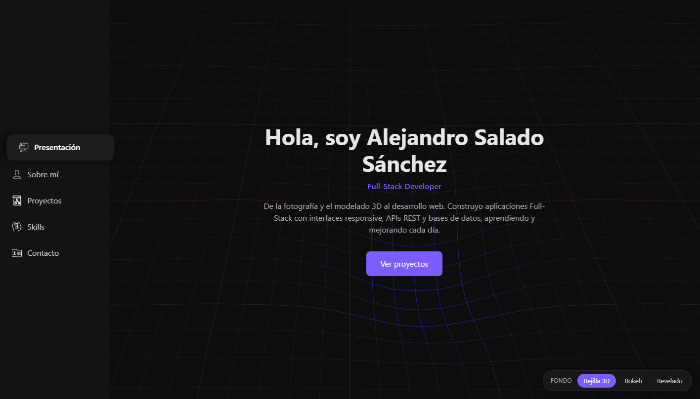

# Portfolio — Alejandro Salado Sánchez

Portfolio personal como desarrollador Full-Stack: experiencia, proyectos, skills y contacto, con fondos animados interactivos y un playground de componentes React que se puede probar en vivo.

**[Ver el portfolio en vivo](URL_DEL_PORTFOLIO)**



## Características

- **Proyectos destacados** con capturas dentro de un marco de navegador. Cada proyecto tiene su propio color y tipografía, y al pasar el cursor se muestra una segunda captura.
- **Tres fondos animados que reaccionan al cursor**, a elegir desde un selector que recuerda la preferencia del visitante:
  - **Rejilla 3D**: malla al estilo de un programa de modelado 3D que se hunde bajo el cursor como un pozo de gravedad (Three.js + shaders GLSL).
  - **Bokeh**: luces desenfocadas que se enfocan alrededor del cursor, como al enfocar con una cámara (Canvas 2D).
  - **Revelado**: grano de película y fugas de luz que siguen al cursor (Canvas 2D + CSS).
- **Playground de componentes**: librería propia (`ButtonAS`, `FormAS`, `InputAS`) con controles para cambiar sus props y ver el código resultante.
- **Navegación lateral** que resalta la sección visible mientras haces scroll.
- **Responsive**, con navegación superior en móvil.

## Tecnologías

- **React 19** y **Vite**
- **CSS moderno**: nesting nativo, custom properties como design tokens, `clamp()` y `aspect-ratio`
- **Three.js** con shaders GLSL propios para la rejilla 3D
- **Canvas 2D** para los fondos Bokeh y Revelado
- **ESLint** con las reglas de React Hooks

## Decisiones técnicas

- **Contenido separado de la presentación**: textos, experiencia, proyectos y skills viven en `src/data/`, así que actualizar el portfolio no requiere tocar componentes.
- **Carga bajo demanda**: cada fondo animado es un chunk independiente que solo se descarga si se elige. Los vídeos de YouTube muestran una portada y solo cargan el reproductor al pulsar play.
- **Animaciones eficientes**: los desenfoques del Bokeh se pre-renderizan una sola vez, la deformación de la rejilla se calcula en la GPU y las animaciones liberan sus recursos al desmontarse.
- **Accesibilidad**: navegación por teclado, estados ARIA (`aria-current`, `aria-pressed`, `aria-expanded`, pestañas con `role="tab"`), foco visible y respeto a `prefers-reduced-motion`, que detiene las animaciones.
- **Capturas automáticas**: las imágenes de cada proyecto se importan con `import.meta.glob` desde su carpeta, sin escribir imports a mano.

## Estructura

```
src/
├── assets/
│   ├── icons/           # Iconos de la interfaz
│   └── projects/        # Capturas de cada proyecto destacado
├── components/
│   ├── layout/          # Estructura de la página (Sidebar)
│   └── ui/              # Componentes reutilizables (FeaturedProject, BrowserFrame, ProjectCard, VideoCard)
├── data/                # Contenido del portfolio (experiencia, proyectos, skills, contacto)
├── features/
│   ├── background/      # Fondos animados y su selector
│   └── showcase/        # Playground de la librería de componentes
│       ├── library/     # ButtonAS, FormAS, InputAS
│       └── playgrounds/ # Controles para probar cada componente
├── hooks/               # Hooks personalizados (useActiveSection)
├── sections/            # Secciones de la página (Hero, About, Projects, Skills, Contact)
└── styles/              # Design tokens y estilos globales
```

### Añadir capturas a un proyecto

Coloca las imágenes en `src/assets/projects/<proyecto>/`. Se ordenan por nombre: la primera es la portada y la segunda aparece al pasar el cursor. El nombre del archivo se usa como texto alternativo, por ejemplo `01-biblioteca.webp` → "biblioteca".

## Instalación

```bash
git clone https://github.com/alex-salsan/MyPortfolio.git
cd MyPortfolio
npm install
npm run dev
```

| Script            | Descripción                    |
| ----------------- | ------------------------------ |
| `npm run dev`     | Servidor de desarrollo         |
| `npm run build`   | Build de producción en `dist/` |
| `npm run preview` | Sirve el build de producción   |
| `npm run lint`    | Análisis estático con ESLint   |

## Contacto

**Alejandro Salado Sánchez**, desarrollador Full-Stack

- LinkedIn: [alejandro-salado](https://www.linkedin.com/in/alejandro-salado/)
- GitHub: [alex-salsan](https://github.com/alex-salsan)
- Email: [alex.salsan97@gmail.com](mailto:alex.salsan97@gmail.com)
